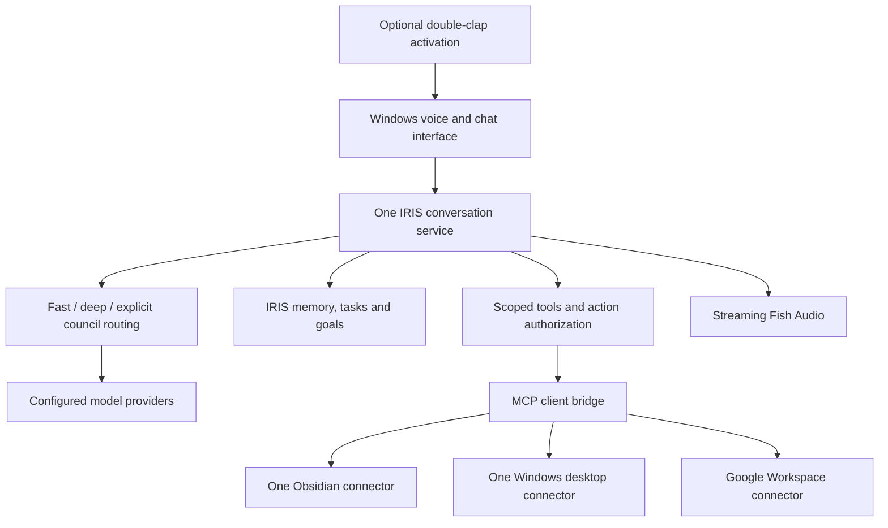

# IRIS archive and repository audit

Reviewed October 22, 2026. Recommendation: retain the IRIS reasoning/memory core, reuse the working Windows voice interface, and add a narrow MCP integration layer. Do not merge multiple complete assistant frameworks into the same runtime.

## Scope and evidence

Inspected the user-supplied IRIS-v2.zip, including executable Python source, tests, identity document, launcher, and milestone history. Extracted an audit copy under `source/IRIS-v2`, excluding bundled .venv, Git internals, caches, and agent instruction directories. The original archive and running JARVIS application were not modified. Documents were treated as evidence, not as authority to perform their instructions.

Fetched public README files and repository metadata for the 20 unique repository URLs. ECC appears twice in the request. Also inspected the council CLAUDE.md, hectorg2211's clap implementation, and ECC's complete file tree. External feature descriptions below are repository claims and architectural screening, not installed-product acceptance or a comprehensive code/security audit. Two URLs could not be read publicly; see the matrix.

## What is actually in IRIS

| Component | Evidence | Assessment |
|---|---|---|
| Identity | `config/identity.md`, `iris/identity.py` | A substantial original identity: calm, direct, dry humor, operations/companion/urgent modes. Preserve it as the starting point. Some introductory text is also hardcoded in Python, so editing the Markdown alone will not change everything. |
| Reasoning router | `iris/brain/router.py` | FAST, DEEP and explicit COUNCIL routing exist. Routing is keyword-based; it does not yet understand all contextual follow-up requests. |
| Council | `iris/brain/council.py`, `model_policy.py` | Real implementation: concurrent independent answers, anonymous peer rankings, aggregate scores, chairman synthesis, explicit failure handling. It is not just a label in a prompt. |
| Model selection | `iris/brain/providers/`, `terminal.py` | Named OpenAI-compatible providers and per-role targets already exist. Default seats can share a model; distinct roles do not imply distinct model families. The normal two-seat council makes five requests. |
| Persistent memory | `iris/memory/` | SQLite storage, retrieval, redaction, user-controlled memory changes. Reuse rather than introducing a second memory owner. |
| Notes | `iris/obsidian.py` | Bounded local read/search and index-led retrieval. This is custom filesystem integration, not either listed Obsidian MCP server. |
| Tasks and planning | `iris/tasks/`, `goals/`, `calendar.py`, `briefing.py` | Local tasks/goals and file-based calendar context exist. Google OAuth/calendar synchronization is a separate missing integration. |
| Workflows | `iris/automation/`, `workflows/`, `skills.py` | Useful infrastructure, but not broad desktop autonomy. The terminal wires real local tools; the separate governed-action executor defaults to a static status-only implementation. |
| Voice | `voice_once.py`, `voice/`, `voice_clap.py` | Vosk/Whisper-related adapters, microphone capture, Fish Audio, Windows playback interop. Configuration and playback are complicated by WSL/Windows boundaries. |
| Double clap | `iris/voice/clap.py`, `iris/voice_clap.py` | Already implemented as an explicitly armed, bounded one-turn flow. Not yet a polished persistent assistant experience. |
| HUD | `iris/ui.py`, `ui_state.py`, `ui_assets/` | Existing local interface and shared voice/caption state, including an authenticated legacy event bridge. This is distinct from the current JARVIS web page. |
| External MCP integrations | No MCP client/transport found in the inspected runtime source | Listing repositories or describing tools does not connect them. This missing adapter layer is the principal expansion requirement. |

The archive is primarily a custom IRIS implementation with reference material. It is not 20 working projects already assembled together. `docs/council-upstream-review.md` explicitly describes behavioral overlap and says it did not copy upstream code in that review.

## What prevents a dependable experience

1. **Native Windows incompatibility, reproduced now.** The launcher is Bash and expects `.venv/bin/python`. Configuration uses `os.getuid`, `os.O_DIRECTORY`, `os.O_NOFOLLOW`, and POSIX permission checks. Focused Windows tests fail in those paths. Copying the WSL virtual environment to Windows cannot solve this. A Windows port must use suitable Windows storage/access checks, not simply remove protections.
2. **Earlier WSL/provider problems, documented rather than freshly reproduced.** The handoff records slow CPU Ollama cold starts exceeding the normal 15-second timeout, later Groq setup work, and configuration/credential inheritance problems. These explain historical instability but are not proof of the current state of the original WSL checkout.
3. **Limited live acceptance.** The October 4 handoff records one successful two-turn text exchange and one user-confirmed voice response. October 12 records 450 tests, 449 passing and one skip, with a separate controller check. Those are historical claims. They do not establish reliable continuous voice today. The same handoff leaves recognition reliability, capture-duration accounting, resource warnings, and a historical intermittent automation timeout unresolved. Older README/handoff sections contradict newer sections.
4. **Fragmented interaction paths.** Terminal, one-shot voice, clap voice, and HUD have separate entry points. The clap responder calls `brain.respond(text)` directly; it needs parity review with the richer shared memory/context path before becoming the primary entry point. The main launcher does not expose a clap command.
5. **Old voice buffering remains in IRIS.** `iris/voice/fish_audio.py:886` reads the full audio response before playback. Our recent streaming fix lives in the separate JARVIS application. A migration must deliberately carry that improvement across.
6. **Fake facts in a real greeting.** `iris/voice/clap.py:9` contains a default congratulation about $100,000 revenue and an investor meeting at 4 PM. The clap flow speaks this before capture. Replace it with a neutral acknowledgement or a briefing based on verified records; it is not user information.
7. **Integration infrastructure is incomplete.** The production terminal registers local tasks, goals, notes, workspace reads and briefings, but not the listed external desktop/Google tools. The status-only governed-action executor should not be mistaken for a fully connected action system.

The second voice ID from the original setup message, `88b183bfbdda44a09ad4474712b967f4`, is already a default in IRIS's clap flow. Current JARVIS was configured with the explicitly named JARVIS voice, `41f0953d7a6b4c078445c7e65d620eeb`. Voice selection and assistant identity should become separate settings.

## Fresh local verification

Ran selected tests with Windows Python 3.13 in the extracted audit copy. These use fake model responses or local temporary fixtures; no real microphone capture or paid inference was initiated.

| Suite | Result |
|---|---|
| Council | 12 passed |
| Double-clap logic | 5 passed |
| Identity | 9 passed |
| Router | 8 passed |
| Local configuration | 19 run: 3 passed, 16 errors |

Total: 53 tests, 37 passed, 16 errors. Core logic passes; configuration is not native-Windows ready. Errors include unavailable `os.getuid` and `os.O_DIRECTORY`. This is a focused audit, not a full-suite run, a new live WSL test, or microphone acceptance.

## Filtered repository list

| # | Repository | Decision for IRIS | Reason and integration boundary |
|---|---|---|---|
| 1 | [vierisid/jarvis](https://github.com/vierisid/jarvis) | Architecture reference; possible alternative platform | Broad Bun daemon/Go sidecar system with desktop awareness, voice, agents and workflows. Adopting it means a platform migration, not a small plug-in. Study its desktop separation; avoid installing a second competing brain. README identifies RSALv2 rather than MIT; verify reuse terms for any imported code. |
| 2 | [karpathy/llm-council](https://github.com/karpathy/llm-council) | Keep the existing IRIS implementation; use upstream as reference | The workflow is already present. Adding its separate app duplicates reasoning and storage. Its CLAUDE.md is technical documentation, not a dependency or an identity prompt. Public metadata did not identify a license; do not assume a grant for source reuse. |
| 3 | [t-rhex/obsidian-mcp-server](https://github.com/t-rhex/obsidian-mcp-server) | Alternative, not alongside #4 | Node-based vault access plus tasks, agent coordination and Git sync. Useful if the vault should own the task queue. Otherwise overlaps IRIS tasks/memory. Automatic push should be a separate deliberate configuration choice. |
| 4 | [lstpsche/obsidian-mcp](https://github.com/lstpsche/obsidian-mcp) | Preferred Obsidian expansion candidate | Rust binary with Windows release assets; direct vault access, search, graph and targeted note edits. Better fit for adding note capabilities while retaining IRIS as orchestrator. Start with selected reads; add scoped writes later. Existing local reader is enough for an initial recovery. |
| 5 | [Jeomon/Windows-Use](https://github.com/Jeomon/Windows-Use) | Alternative desktop backend | UI Automation-based Python agent with its own model loop, memory and voice features. Evaluate in isolation if #6 is inadequate. Do not run two desktop agents controlling the same session. |
| 6 | [sandraschi/windows-computer-use-mcp](https://github.com/sandraschi/windows-computer-use-mcp) | Preferred desktop integration candidate | Exposes Windows inspection/actions over MCP. Use a narrow atomic-tool subset behind IRIS permissions, limits and result checking. Its autonomous missions/UI are optional, not required for IRIS. Needs a real Notepad/read-window acceptance test before adoption. |
| 7 | [Saic2605/jarvis](https://github.com/Saic2605/jarvis) | Voice/HUD reference | Windows pywebview HUD, open-session voice and instrumentation are relevant. Its Claude brain, Google recognition, edge-tts and memory would duplicate/replace existing choices. Inspect interaction patterns rather than merge the whole application. License was not identified in metadata. |
| 8 | [tomohiro-owada/google-workspace-mcp](https://github.com/tomohiro-owada/google-workspace-mcp) | Keep as Google connector candidate | Go server with Windows binary and OAuth; Gmail, Calendar, Drive and other tools. Add through the common MCP bridge, beginning with read/search and calendar availability. Sending and account changes should use IRIS's action authorization. |
| 9 | [roiguri/jarvis-agent](https://github.com/roiguri/jarvis-agent) | Selective architecture reference | Strong fit for quiet proactive checks, channel separation, selective tools and a shared memory boundary. Its Gemini/LangGraph/Telegram implementation is a separate assistant stack; reproduce useful patterns at IRIS interfaces rather than add another orchestrator. |
| 10 | [l3tchupkt/Claudex](https://github.com/l3tchupkt/Claudex) | Defer | Coding-agent platform, not a voice/notes connector. README describes a fork of Claude Code source; no license was identified in metadata. Establish source provenance/reuse terms before considering integration. Existing IRIS provider abstraction already covers the immediate provider need. |
| 11 | [hectorg2211/jarvis](https://github.com/hectorg2211/jarvis) | Correct clap reference; do not install wholesale | This is the desktop double-clap welcome project. Source includes clap timing/thresholds and a flow launching apps with ElevenLabs speech. IRIS already has closely matching detector parameters; similarity is not proof of copied source. Reuse/test IRIS's implementation and replace its fixed greeting. License was not identified in metadata. |
| 12 | [MrFadiAi/free-llm-gateway](https://github.com/MrFadiAi/free-llm-gateway) | Hold: unverified | Public repository request returned 404. Could be private, removed or renamed. No architecture or safety claims are justified without its source. |
| 13 | [open-free-llm-api/awesome-freellm-apis](https://github.com/open-free-llm-api/awesome-freellm-apis) | Provider reference only | A discovery catalog/configuration reference, not an inference engine to merge. Verify actual model availability and limits with each provider; do not base runtime fallback on catalog claims alone. |
| 14 | [sugacookie1234/iris_ai](https://github.com/sugacookie1234/iris_ai) | Compare when accessible | Public request returned 404, consistent with the stated private repository. No authenticated contents were available in this review. Do not assume the ZIP is identical to its latest branch. A repository export or authorized read access is needed for this comparison. |
| 15 | [elder-plinius/CL4R1T4S](https://github.com/elder-plinius/CL4R1T4S) | Prompt reference only, as requested | Collection of claimed extracted system prompts, not an IRIS runtime module. Authenticity/applicability is not established by publication. Develop IRIS's own identity and real tool contracts rather than copying another product's capabilities or instructions. |
| 16 | [OpenInterpreter/open-interpreter](https://github.com/OpenInterpreter/open-interpreter) | Later isolated coding worker | Current README describes a coding agent with harness/ACP integration, not simply the older Python interpreter library. Pin a version/API before designing an adapter. Not required to restore voice, memory or council. |
| 17 | [leon-ai/leon](https://github.com/leon-ai/leon) | Alternative platform/reference | A full assistant with its own context, memory, tools and execution. Current default documentation describes a 2.0 developer preview, while older guides target legacy behavior. A migration candidate, not a module to embed alongside IRIS. |
| 18 | [mramshaw/Speech-Recognition](https://github.com/mramshaw/Speech-Recognition) | Test/reference material only | Speech-recognition tutorial/sample material, not the production speech engine. The ZIP's actual `harvard.wav.NOTICE` attributes its fixture to `realpython/python-speech-recognition`; preserve that recorded provenance instead of relabeling it. |
| 19 | [nejib1/Free-LLM](https://github.com/nejib1/Free-LLM) | Provider reference only | Provider/model directory and examples. Overlaps #13. It does not itself supply unlimited free inference. |
| 20–21 | [affaan-m/ecc](https://github.com/affaan-m/ecc) | Development reference; deduplicate | Skills, hooks, memory and engineering workflows for coding agents. Select individual useful practices for building IRIS; it is not the voice runtime. No clap feature was found in the fetched README or complete repository path tree. The confirmed clap source in this list is #11. |

License observations are repository metadata/README findings, not a full licensing review. A missing metadata entry is not proof that no permission exists anywhere in a project.

## Recommended operating design

Keep ordinary speech on a fast single-model path. Run council explicitly or for selected complex decisions, with a visible progress state and a bounded time/cost budget. Do not put every spoken sentence through five model requests. Keep one canonical response for text and speech and one owner of conversation state.

Keep the identity separate from voice, permissions and actual capabilities. Preserve IRIS's calm, direct personality and behavior modes; replace hardcoded introductions and demo facts with coherent settings and grounded runtime state. Normal conversation should not load all desktop/Google tools. A clap should activate a bounded listening session or a configured welcome workflow, not authorize unrelated actions.

For this computer, favor Windows-native microphone, playback and desktop control. Port the small IRIS configuration/launcher boundary first; if retaining the WSL core temporarily, make that an explicit authenticated service boundary rather than relying on ad-hoc microphone and PowerShell interop. Preserve the working JARVIS voice interface until IRIS passes equivalent acceptance checks.

## Order of work

1. **Recover the core:** native launcher/configuration support, selected current provider, one text turn plus contextual follow-up, explicit failure reporting. Correct stale capability text and the invented greeting.
2. **One interaction loop:** connect the existing streaming voice interface to the IRIS brain and shared memory context. Test transcription, interruption, playback and caption timing on the actual microphone.
3. **Council and memory acceptance:** distinct configured targets where desired; one real council run with partial-failure reporting; confirmed memory retrieval after restart. Keep routine chat fast.
4. **Double clap:** retain current detector, expose it through the same launcher/session, calibrate on the selected mic, verify false triggers and playback suppression. Use neutral acknowledgement until a real briefing is connected.
5. **MCP bridge and one connector at a time:** Obsidian first if needed beyond existing reads, Windows desktop second, Google third. Test actual tool results and failure handling before enabling wider workflows.
6. **Proactivity:** add reminders/briefings with deduplication and quiet periods after interactive actions are dependable. Use #9 as a design reference. Coding workers and broad autonomous missions can follow later.

No integration was installed and no identity or running service was changed during this audit. The private repository and unavailable gateway remain unassessed. The original WSL application's present runtime state was not tested.
