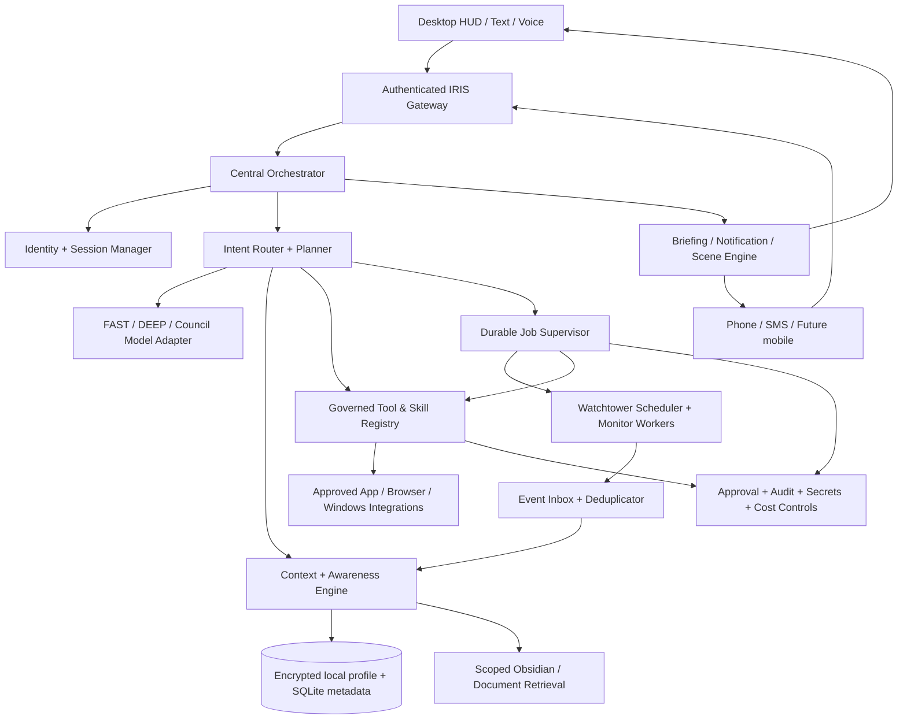

# I.R.I.S. v3 — Master Product & Technical Design

> **Status:** Proposed design baseline (not an implementation claim)  
> **Version:** 0.1.0-draft  
> **Created:** 2026-10-28  
> **Canonical repository:** [`sugacookie1234/iris-v3-capable-laptop`](https://github.com/sugacookie1234/iris-v3-capable-laptop)  
> **Baseline revision reviewed:** `9db02a7e9b3ed9dcc4e28dc64270a802cbe4ad28` (`main`, 2026-10-28)  
> **Companion documents:** [Capability Tracker](IRIS_CAPABILITY_TRACKER.md), [Codex Collaboration Protocol](IRIS_CODEX_PROTOCOL.md), [Decision Log](IRIS_DECISIONS.md).

**Interpretation rule:** *Designed* ≠ *implemented* ≠ *automated-test verified* ≠ *live verified*. The existing implementation descriptions below are derived from repository source, README and validation notes, not from a fresh run on the user's HP OMEN. This document states desired behaviour; it does not authorise a coding agent to perform external actions or modify personal accounts.

---

## 1. Vision and product contract

I.R.I.S. (Integrated Reasoning and Intelligence System) is a **single, persistent, local-first personal intelligence and operations system** with a coherent personality, contextual memory, deep reasoning, authorised tools, proactive monitoring, and optional remote communication. It should feel like a dependable personal chief of staff with a cinematic interface, **not** a simulated JARVIS dashboard.

### The four product pillars

1. **Presence:** natural text/speech, configurable double-clap awakening, contextual greetings, personal scenes, restrained HUD and good conversational continuity.
2. **Intelligence:** trusted context retrieval, awareness of relevant life events and commitments, deliberate model routing, a real multi-model Council when justified, independent judgement and uncertainty disclosure.
3. **Operations:** tasks, goals, projects, email/calendar/Notion integrations, bounded desktop control, reusable skills, safe multi-step jobs and future business assistance.
4. **Watchtower:** opt-in monitoring of interests, awaited replies, releases and deadlines; relevant, non-duplicative alerts; time-aware briefings; optional phone/SMS when authenticated and configured.

### Product principles

- **Reality over spectacle.** Every assertion about a completed action comes from a verified tool result. A scene's greeting may be theatrical; its facts must be grounded.
- **One IRIS, many workers.** Models, coding agents and skills are workers, not competing owners of identity, history or permission policy.
- **Local-first, not local-only by default.** Keep storage and orchestration local when practical. Explicitly identify cloud inference, voice and connector boundaries.
- **Consent and proportionality.** Read only authorised sources; proactively monitor only user-approved subjects. Never infer an interest from browsing history and silently start surveillance.
- **Action permission is separate from model capability.** A model, tool, skill, webpage, email or Council conclusion cannot grant itself authority.
- **Graceful failure.** Text chat must remain useful without the HUD, microphone, Fish Audio, provider, cloud, phone bridge or an individual integration.
- **Cost and resource awareness.** The Council, search, transcription, hosting, SMS and calls may incur separate costs; visible budgets and caps are mandatory.
- **Auditable progress.** A capability is complete only after tests and the specified manual/live acceptance where applicable.

### Non-goals and current exclusions

No unrestricted shell or blanket desktop access; no automatic financial transfers or purchasing; no unreviewed installation of arbitrary internet skills; no covert listening or recording; no continuous screen surveillance; no fabricated user achievements; no autonomous outbound communication to third parties without precise permission; no replacement of IRIS v3 with another complete assistant stack. Notion Calendar is not a substitute for a general calendar API. There is no expectation that a sleeping laptop performs background monitoring unless an independently hosted worker exists.

## 2. Product behaviour, identity and tone

Keep the canonical personality in [`config/identity.md`](../config/identity.md): observant, calm, competent, warm but not obsequious, direct, subtly dry-witted, able to challenge bad assumptions, and never falsely certain. Existing NORMAL, OPERATIONS, COMPANION and URGENT modes are *behavioural modes* of the same IRIS.

**Introduction direction:** use the collaboratively refined introduction as a candidate; reconcile it with `config/identity.md`, `iris/identity.py`, and any hard-coded deterministic replies through a separate explicitly reviewed change. Written canonical name may remain `IRIS` or `I.R.I.S.` as project policy; voice must pronounce it naturally as “Iris”. The design document does not silently change source-of-truth identity text.

Voice replies should ordinarily be shorter than visual/text summaries. On a fun homecoming scene, a user-defined address such as “sir” and an opt-in theatrical phrase (including “Daddy's home”) are legitimate presentation preferences; no default pet names, false compliments or invented accomplishments. In emergencies and approval dialogs, drop the theatre.

**Conversation contract:** understand natural follow-ups, remember only as allowed, say what was retrieved, distinguish expectation from reality, ask for permission only when material, and report time, actions and errors accurately.

## 3. Signature user journeys and measurable outcomes

| ID | User journey | Required outcome |
|---|---|---|
| UJ-01 | Double clap after returning home | Wake once, select the right authorised scene, start selected apps/music and speak a factually grounded briefing; no duplicate scene on repeated noise. |
| UJ-02 | “I felt good about my exam today” | Capture optional dated, self-reported event; don't invent grade/course; refer to it at a relevant later briefing with permission. |
| UJ-03 | “Watch for Lupin season 5 news” | Create opt-in interest monitor; compare credible updates with prior findings; notify only on genuinely new, sourced information. |
| UJ-04 | “Tell me when the professor responds” | Associate authorised mailbox thread with an active case; detect replies; summarise with correct provenance and adjust next action. |
| UJ-05 | “What have you done today?” | Provide an audit-backed report of completed, failed, pending and awaiting-approval work, with links to evidence. |
| UJ-06 | “Call me if an urgent monitored event occurs” | Only escalate under an explicitly approved rule; authenticate access; deliver a short, truthful notification; enforce quiet hours and rate limits. |
| UJ-07 | “Prepare a business idea and operating plan” | Research, evaluate, cost, draft, compare; execute only bounded approved workflows; do not claim the business has been launched. |
| UJ-08 | “Use Codex to fix the bug” | Delegate in scoped repository workspace; retrieve patch and test evidence; preserve uncommitted work; human reviews before merge. |
| UJ-09 | “Bring over my ChatGPT history” | Local import, dedupe, sensitivity screening, corrections and explicit consent before writing durable memories; reversible and inspectable. |
| UJ-10 | “What's important tomorrow?” | Combine authorised tasks, deadlines, verified calendar and cases; prioritise, dedupe and plainly state missing source access. |

## 4. Current code baseline (as of 2026-10-28)

This inventory is based on the repository snapshot and its `README.md` / `docs/VALIDATION.md`. It must be revalidated whenever current source changes. Existing code is **not** a reason to skip tests.

| Area | Observed repository evidence | Baseline conclusion |
|---|---|---|
| Windows application | `iris/desktop/app.py`, `runtime.py`, `server.py`, `tray.py`, `web/` | Native pywebview/HTML UI and tray lifecycle exist; OMEN hardware acceptance still outstanding. |
| Voice and wake | `iris/desktop/clap_listener.py`, `recognition.py`, `web/voice-input.js`, Fish Audio paths | Double-clap, speech turns, five-second follow-up concept, Fish ASR and local faster-whisper fallback implemented; real-room performance unverified. |
| Routing and Council | `iris/brain/router.py`, `engine.py`, `council.py` | FAST/DEEP/COUNCIL; independent answers, anonymous review and synthesis; initial seats can share a model, so diverse providers not guaranteed. |
| Memory and Obsidian | `iris/memory/`, `iris/obsidian.py`, `iris/desktop/notebook.py` | Local approved memories and bounded note retrieval/editing; no complete personal event/case knowledge graph. |
| Tasks/goals and organisation | `iris/tasks/`, `iris/goals/`, `iris/desktop/organizer.py` | Local task/goal/note capture and some undo/Activity behaviour; semantic capture imperfect in live smoke tests. |
| Workflow/automation and tool authority | `iris/automation/`, `iris/workflows/`, `iris/tools/` | Real building blocks; not yet general long-running cross-app autonomy. |
| Research | `iris/desktop/web_search.py` | Explicit `/search` and web requests; not continuous automatic browsing. |
| Phone | `iris/phone/`, `docs/PHONE.md` | Optional Twilio SMS and PIN-protected calls; provider setup required; currently separate from desktop memory/tools. |
| External connectors | `docs/INTEGRATIONS.md` | General Windows computer-use, Google Workspace and Notion service connectors not yet installed. |
| Validation | `docs/VALIDATION.md` | Reported 741 passing Windows tests and four skips on 2026-10-27, later focused tests on 2026-10-28; not a fresh OMEN run. |

### Hardware and deployment baseline

Target: **HP OMEN 16 / Intel Core 7 240H / 16 GB RAM / RTX 5060 Laptop GPU / 1 TB SSD**, per the v3 README. Design for native Windows first; the local UI currently binds to loopback. Benchmark actual available VRAM, thermals, wake reliability, capture device, local ASR and concurrency on this device before changing model defaults. Cloud reasoning and Fish services are separate external trust and billing boundaries.

## 5. Logical architecture and responsibilities



### Runtime boundaries

- **Existing** `DesktopRuntime`: one conversation owner and UI interface. Retain it as the interactive facade, but avoid running long background work under its single turn lock.
- **New** `iris/awareness/`: memory enrichment, dated events, interests, active cases, provenance and contextual briefing assembly. Existing memory remains canonical for confirmed facts; do **not** create a competing memory store.
- **New** `iris/scenes/`: declarative triggers, state-aware scene selection and governed app action sequences.
- **New** `iris/integrations/`: typed provider adapters, credential scopes, pagination, rate limits, error mapping and safe OAuth refresh.
- **New** `iris/watchtower/`: opt-in monitor definitions, polling/subscription consumers, change detection, alert decisions and digest builder.
- **New** `iris/agent_jobs/`: durable asynchronous job state, retries, deadlines, cancellation, dependency tracking and evidence.
- **New** `iris/skills_engine/`: discovery, validation, approved procedures and confined worker execution; the central tool registry remains the execution authority.
- **Shared** event infrastructure: durable event inbox/outbox, versioned schemas and idempotent consumers; avoid a new heavyweight broker initially.

The directories are proposals, not currently created files. Subsystems must depend on stable interfaces, not import one another's internals indiscriminately.

## 6. Canonical data model and information flow

### 6.1 Core records

Proposed local, schema-versioned records (fields illustrative; final migrations require review):

```text
PersonalMemory(id, kind, summary, source_ref, observed_at, valid_from,
               valid_until, confidence, sensitivity, consent_scope, supersedes_id)
PersonalEvent(id, event_type, occurred_at, source_ref, summary, confidence,
              subject_ids, sensitivity, retention_policy)
ActiveCase(id, title, kind, status, priority, related_event_ids,
           related_task_ids, source_refs, next_check_at, owner, updated_at)
Interest(id, topic, sources, monitoring_permission, interval, last_checked,
         last_digest, notify_policy, paused)
WorkflowJob(id, kind, plan_version, approval_scope, state, progress,
            current_step, idempotency_key, attempts, started_at, updated_at)
ToolAudit(id, job_id, tool, argument_digest, approval_id, outcome,
          effect_receipt, happened_at, redacted_error)
Scene(id, trigger, conditions, actions, quiet_hours, cooldown, version, enabled)
MonitorObservation(id, monitor_id, source_key, content_fingerprint,
                   observed_at, event_date, evidence_refs, significance)
```

**Principles:** source timestamps and event timestamps differ; a user self-report is never an official grade; a prediction is never a confirmed future event; one fact may supersede another; records have retention and sensitivity; private memory data must not enter Git or debug logs. New SQLite tables should use schema migrations and tests, not raw ad-hoc writes.

### 6.2 Event contracts

Version every envelope, e.g. `{id, schema_version, type, happened_at, producer, subject, sensitivity, payload_ref, correlation_id}`. Useful event types: `wake.detected`, `scene.started`, `scene.action_completed`, `conversation.user_fact_proposed`, `case.updated`, `mail.reply_detected`, `monitor.changed`, `approval.requested`, `job.finished`, `briefing.ready`.

Keep event payloads minimal; reference sensitive content by local ID instead of copying it through logs. Implement local SQLite outbox + worker polling initially, with an idempotency key and acknowledgement semantics. Later swap to a broker only if measured throughput requires it.

### 6.3 Context assembly

`request → classify → permission filter → relevant memories/events/cases → fresh tool reads if necessary → bounded prompt → answer + provenance → optional memory proposal`.

Retrieval is index-first and scope-aware. Add deterministic search/FTS and metadata filtering before embeddings; embeddings are optional if benchmarking demonstrates improved relevance. Prevent untrusted email, web pages, notes, repositories and skill contents from becoming executable instructions.

## 7. Presence: wake detection, scene orchestration and briefing

### 7.1 Scene sequence

1. Native clap detector reports a **confirmed** wake event with device and confidence/diagnostic metadata; never falsely claim a wake after recording is disabled.
2. Wake controller applies cooldown, deduplication, user availability and microphone permission.
3. Scene selector chooses a user-configured rule (morning, arriving home, focused work, evening, gaming, or default listening). **Time alone is not proof of arriving home.**
4. Scene planner expands deterministic, allowlisted actions: open browser/workspace, launch permitted app, start authorised playlist, assemble briefing.
5. Action executor validates each step via existing permission boundary and records success/failure separately. Audio/music must not falsely trigger clap detection or be retranscribed.
6. Briefing aggregator retrieves verified calendar, tasks, active cases, recent events and selected monitors; labels missing or stale integrations.
7. A fast model or template synthesises a short response; Fish Audio speaks while HUD shows actual listening/thinking/speaking/acting states. Support interruption and follow-up.
8. Final Activity entry records actions completed, skipped, failed and notifications delivered.

### 7.2 Declarative scene example

```yaml
id: welcome_home_evening
trigger: double_clap
conditions:
  local_time: "17:00-23:00"
  cooldown_seconds: 60
  require_user_enabled: true
actions:
  - type: app.open
    app_id: chrome
  - type: url.open
    bookmark_id: notion_workspace
  - type: music.play
    playlist_id: evening
    on_unavailable: skip
  - type: briefing.prepare
    sections: [tasks, calendar, cases, recent_events, important_updates]
  - type: voice.speak_briefing
policy:
  external_writes: deny
  allow_in_quiet_hours: false
```

No literal path/URL in the scene should imply execution approval. Scenes can be dry-run previewed and interrupted. User-customisable address and dramatic greeting are allowed **only as presentation**, without falsifying events.

### 7.3 Briefing quality rules

Always distinguish: **confirmed**, **user-reported**, **inferred**, **expected**, and **unavailable**. Do not congratulate the user on a grade or conference merely because an assistant predicted it. Enforce a source freshness limit for calendar/mail/weather and allow the user to correct events. Night mode should not interrupt except for explicitly whitelisted emergencies.

## 8. Intelligence: provider routing and Council

- **Level 0 — deterministic:** clap state, safety checks, time formatting, routing to local tools, dedupe, recurring scheduler.
- **FAST — ordinary chat:** one low-cost, configured model; context only if relevant; concise spoken response.
- **DEEP — complex tasks:** stronger model and additional retrieval, visible reasoning effort/cost estimate as available.
- **COUNCIL — consequential or explicitly requested:** independent candidates, anonymous ranking/review, chairman synthesis; show partial failures and model/provider diversity truthfully. Distinct role prompts using the *same* model must not be labelled as separate AI models.

Council output is advice, **not** execution authorisation. Put a resource budget around Council usage. Track token counts/provider charges when available and never silently switch from free to paid inference. Add evals for hallucination, follow-up reference resolution, retrieval relevance, factuality of briefings and tool-routing correctness. Judge quality from repeatable tasks, not benchmark slogans.

## 9. Memory migration from ChatGPT and other sources

Create a separate import workflow, not a direct one-shot database dump:

1. The user obtains a ChatGPT data export and selects local files for import; any context available in this conversation is only a partial source.
2. Parse and chunk locally; retain provenance by conversation/date; remove secrets and data unrelated to IRIS's purpose.
3. Classify candidates into stable preferences, ongoing projects, past events, decisions, commitments and expired facts.
4. Deduplicate, detect contradictions, flag sensitive categories and rank by relevance. Use local inference when possible; cloud extraction requires explicit consent.
5. Show an editable import preview; **nothing durable is saved until approved**. A manual review must be available without relying on the model.
6. Commit approved records through the existing memory policy with import transaction ID and versioned migration. Support rollback, deletion and export.
7. Validate retrieval on selected scenarios; prevent the chat export from being included in Git history or logs.

Suggested location: encrypted app data, not repo `.local` if eventual backup/security review recommends moving it. Current README notes local SQLite personal records are plaintext even though Windows DPAPI protects configuration. Encryption-at-rest and backup recovery are separate design tasks, not claimed present.

## 10. Awareness and personal-manager semantics

An **event** is something that happened. A **case** is something unresolved that IRIS follows up on. An **interest** is a subject authorised for periodic watching. They are separate entities.

Example: “I felt good on my exam today” → proposed `PersonalEvent(self_report)` → optional link to a course case → evening briefing can mention the reported feeling. “Waiting for professor reply” → active `Case(waiting)` linked to a confirmed email thread with a `next_check_at` → event on new reply → case updated → perhaps notification or draft suggestion. Don't infer the owner wants continual email surveillance from a single conversation.

Support statuses `open`, `waiting`, `blocked`, `needs_approval`, `resolved`, `archived`; all changes include reason/source. Set expiration on temporary cases to prevent indefinite monitoring. Provide a simple UI to review and pause all active monitors and case automation.

## 11. Integrations and desktop control

### Adapter contract

Every connector implements explicit capabilities (`list`, `get`, `search`, `draft`, `write` where authorised), typed schemas, auth scopes, timeouts, retries/rate limits, paginated reads, source timestamps and test doubles. The central executor performs authorisation **before** invoking a connector. Never give raw provider OAuth tokens to an LLM or imported skill.

| Connector | Target first slice | High-risk gates |
|---|---|---|
| Microsoft Graph / Outlook | Read selected school mail threads and calendar events; create reply drafts | Sending, deletion, moving, broad mailbox rules, cross-account access require confirmation |
| Gmail / Google Calendar | Selected inbox and calendar reads; drafts; events | Sending, event cancellation, account settings require confirmation |
| Notion | Read and search approved pages/databases; propose updates | Publishing/sharing/deleting pages or changing access requires confirmation |
| Notion Calendar | Launch/open selected UI; use underlying connected provider for event data | Never invent full Notion Calendar API semantics |
| Spotify / local audio | Launch a known playlist; playback with the user's consent and required subscription | No account-wide modifications or unexpected playback |
| Windows | Open allowlisted apps, inspect permitted windows and apply scoped UI actions | Avoid blind clicks, privilege escalation, arbitrary scripts, credential windows |
| Browser (Playwright) | Inspect trusted sites, navigate approved workflows, extract structured data | Confirm submissions, account changes, purchases and uploads |
| Twilio phone/SMS | Owner-only conversations, escalations and status notifications | Identity verification, explicit destinations, communication limits and opt-out |
| GitHub / Codex | Read repos, create changes in isolated worktrees/branches, run tests and show diffs | Merge, publish, delete, secrets and destructive operations require confirmation |

**Desktop priority:** try official API first; deterministic native process launching second; Windows UI Automation third; computer vision/coordinate clicks only if necessary and observable. Never treat a successful click as proof an external action completed; read back the result where possible.

**Credentials:** local account-scoped secret storage, minimal OAuth scopes, explicit re-authorisation, no credentials in log/prompt/repository. Remote messages or event webhooks are untrusted input. Phone identity and permissions are channel-scoped; an incoming phone PIN is not universal approval for financial or destructive actions.

## 12. Watchtower: scheduled and conditional monitoring

The automation scheduler should register approved `MonitorDefinition` records, e.g. topic/sources/interval/criteria/cost cap/freshness/expiration/notification. Use webhook/change feeds if practical; otherwise poll with jitter, conditional requests, backoff and quotas. The monitor saves a compact `Observation` (event date, retrieval time, URL/source, fingerprint, confidence); deterministic comparison precedes any model classification.

`Scheduler → Connector → Normaliser → Newness/Deduper → Relevance Classifier → Case Update → Notification Policy → Audit`.

**Notification tiers:** store silently; include in next digest; low-disruption banner; owner-only message; emergency call **only** for explicit, narrowly scoped rules. Apply quiet hours, per-topic dedupe, frequency caps, kill switch and notification receipts. Never report undelivered SMS as received. A waiting reply can be a monitored case; a TV season release is an interest monitor. Actual monitoring requires the host to be available—desktop tray works only while the laptop is awake; future optional always-on host has a separate trust model.

### Watchtower acceptance cases

- First source snapshot produces **no** false “new update” alert.
- Duplicate, edited headline or syndicated copy does not repeat an alert without substantive changes.
- Source unavailable or stale yields a truthful degraded status, not invented confirmation.
- A legitimate new official announcement creates one evidenced, appropriately prioritised notification.
- Pausing or deleting a monitor stops further checks and expires its stored tokens/queues as policy permits.

## 13. Long-running jobs, skills and worker agents

### Durable workflow contract

Jobs transition `queued → running → verifying → completed`, or `paused / needs_approval / failed / cancelled`; each step tracks attempt count, wall-clock deadline, actor, evidence and idempotency key. On restart, reconcile incomplete external side effects before retrying. Use compensating actions for reversible changes and require human approval for uncertain irreversible operations. Separate background worker from the desktop chat lock; the event stream may deliver progress to the HUD without blocking conversation.

### Skills library

Treat `SKILL.md` and supporting resources as procedural *content* with declared inputs, outputs, tools, permissions and test fixtures. Skills can suggest actions but cannot grant permissions, self-install dependencies or mutate the tool registry. Trusted skills load on demand; untrusted downloaded skills require manual review and sandboxing. Run coding workers in isolated repo worktrees/containers where practical, with no secret access by default and explicit network/workspace policy.

### Council versus workers

The Council evaluates decisions. Worker agents execute bounded tasks. A strategist or sceptic role is **not** a separate autonomous agent unless it has an independent execution context and explicitly defined authority. IRIS remains accountable for validating results before reporting completion.

## 14. Phone, remote access and always-on operations

Preserve current opt-in Twilio phone bridge. Future architecture routes authenticated phone sessions through a shared owner-profile gateway, using **channel-restricted** memory and tools. Phone recordings are not saved by default; third-party transport/STT can still process content under provider terms. Owner-number allowlisting and PIN are useful but insufficient for high-risk actions. Add replay-resistant session auth, optional device confirmation, session TTL, inbound rate limits and abuse monitoring.

Separate the desktop control plane from a public webhook bridge; never expose the local HUD server directly to the internet. For monitoring during sleep or shutdown, deploy a minimal separately authenticated always-on worker (optional mini-PC or cloud instance) containing only required scopes and data, synchronised via encrypted, authenticated channels. Do not require always-on deployment for the first working milestones.

## 15. Interface, visibility and settings

Owner-requested extensions: CAP-37 uses bounded versioned visual data rendered by
local components, never model-generated executable HTML/JavaScript. CAP-38 adds
scoped decision cards; ordinary selection never grants consequential authority.
Interactive compound interest and business comparisons are initial targets;
implementation status remains in the capability tracker.

Keep the existing restrained dark HUD, central iris animation, truthful microphone/listening states and live captions. Add on-demand panels for:

- **Today:** briefing, events, tasks and outstanding cases.
- **Activity:** time-ordered actions, errors, links and Undo where supported.
- **Watchtower:** monitored interests, latest check, last change, pause and notification level.
- **Scenes:** presets, trigger/quiet-hour configuration, dry-run preview, per-action enable switch.
- **Jobs:** queue, progress, approvals, retries, evidence and cancellation.
- **Memory:** searchable/correctable facts and source/consent inspection.
- **Costs and privacy:** provider/model, quota, history retention, microphone/audio routing and remote connectivity.

Never show demo data as live telemetry. If a service is missing, state it explicitly and allow the rest of the application to operate. Support keyboard and screen-reader use in addition to gestures and speech.

## 16. Permissions, threat model and reliability

### Authority tiers

| Tier | Examples | Default treatment |
|---|---|---|
| GREEN | Read allowlisted files/calendar metadata, calculate, retrieve saved tasks, preview a scene | May execute after scoped opt-in, with audit |
| YELLOW | Reversible local note/task writes, open configured apps, update approved personal workspace | Contextual permission or narrow standing grant with Undo and expiration |
| RED | Send messages, place calls to new contacts, publish/share/delete, purchases, financial transfers, security changes, destructive shell/file actions | Fresh, explicit, exact-argument approval; no blanket delegation |

All approvals bind actor/channel, action, canonical arguments, recipient, scope, time, expiry and nonce. One-time approvals cannot be replayed or silently broadened by tool results. Informational web, emails, notes, repository README and imported skills are **untrusted data**, not commands.

### Reliability and privacy requirements

- Fail closed on unknown tool name, malformed schema, credential error, expired approval or ambiguous identity.
- Add request and workflow timeouts, cancellation and explicit “possibly performed” state on uncertain external effects.
- Use allowlists and secure local path traversal/junction checks; no untrusted shell command interpolation.
- Encrypt high-sensitivity personal records where feasible, control backups and implement real deletion/export. DPAPI configuration encryption does **not** currently encrypt all SQLite data.
- No persisted audio by default; source/channel-specific upload consent and clear recording indicator.
- Default logs contain IDs, timings, status and redacted errors—not full email, medical, financial, personal notes, secrets or audio.
- Secure webhook signature verification, browser origin checks and local-only service binding. Mandatory security review before an internet-reachable service.
- Prevent unauthorised third-party interactions, runaway loops and billing surprises with explicit quotas and rate caps.

## 17. Validation, performance and operational observability

No arbitrary percentage should be presented as already achieved. The following are **proposed acceptance targets**, to be calibrated on the HP OMEN and realistic test fixtures:

| Dimension | Proposed acceptance criterion |
|---|---|
| Text reliability | Text conversation still works when mic/Fish/phone/one connector fails; regression suite green |
| Session truth | Canonical displayed response matches spoken content; no demo status displayed as live |
| Wake reliability | Test ≥100 diverse real-room wake/no-wake trials with logged false positives, missed activations and conditions before enabling automatic scenes by default |
| Scene execution | Every declared step produces verified `success`, `skipped`, `failed` or `needs_approval` record; duplicate activation suppressed |
| Personal briefing | All factual assertions trace to source, verified tool record, or marked user report; stale/inaccessible sources disclosed |
| Monitor correctness | Initial snapshot silent; repeat findings deduped; new source-grounded change reported once; pause respected |
| Job recovery | Simulated crash/restart does not duplicate external writes or silently complete partial jobs |
| Permissions | Deny unapproved RED tasks from chat, phone, Council, webpage and skill inputs; replay/expiry tests |
| Data hygiene | Personal files excluded from Git; secret scan; memory review/delete/export and encrypted backup recovery tested |
| Cost controls | Per-provider daily/monthly budget and ceiling enforced; estimated vs actual usage shown where possible |

Capture environment, version/commit, device, model IDs, date, number of tests and real-vs-fake service boundaries in `docs/VALIDATION.md`. A mock provider passing tests never counts as a live SMS, call, webhook, physical clap or OMEN acceptance.

## 18. Milestones and dependency order

**M0 — Baseline and design adoption.** Audit current `main`, run existing tests without paid calls, verify documentation, agree on this draft; set up capability tracker and PR discipline.

**M1 — Awareness foundation.** Add schema-migrated events, cases and interests; implement consent-controlled storage, source provenance, basic UI, retrieval and recovery tests.

**M2 — First signature scene.** Reuse the wake pipeline to trigger a configurable, permission-checked Welcome Home scene with local apps and truthful task/event briefing, Fish output and Activity log. Start without external email/Spotify dependencies, then add them incrementally.

**M3 — Personal memory import.** Local ChatGPT export importer and review/undo UI; retention, sensitive-data and provenance tests. Do not import private data into Git or external providers implicitly.

**M4 — Practical app connectors.** Microsoft/Google calendar and email read/draft adapters, Notion read, selected Windows/Spotify operations, authenticated setup, scopes, fixtures and live owner acceptance. One connector at a time.

**M5 — Watchtower v1.** Persistent interest and awaiting-reply monitors, durable dedupe, notification policy and case linkage; owner-controlled pause and quiet hours.

**M6 — Remote unified profile.** Authenticated phone gateway with subset of shared context and active cases; explicit outreach escalation policy and rate/cost caps.

**M7 — Skill & agent delegation.** Trusted skills loader, bounded Codex/Claude workers, job state machine, test/evidence harvesting, limited multi-step workflows and recovery.

**M8 — Always-on and business operations.** Optional independent host, encrypted sync, targeted recurring business procedures and end-to-end cost/security/availability review.

Dependencies: M0 before all; M1 before contextual M2/M3/M5; M4 before email-driven M5; M5/M6 before remote proactive escalation; M7 before broad business autonomy; M8 only once permissions and observability are mature. Parallel UI polish can proceed provided it never masks absent functionality.

## 19. Governance and ongoing document updates

This file is the **product and technical intent**, not the real-time completion dashboard. See [Capability Tracker](IRIS_CAPABILITY_TRACKER.md) for per-feature status and evidence, [Decision Log](IRIS_DECISIONS.md) for accepted/pending decisions, and [Codex Collaboration Protocol](IRIS_CODEX_PROTOCOL.md) for recurring updates.

Every feature PR should map one or more capability IDs to implementation changes, tests, validation notes, rollback and risks. A Codex implementation must **not** silently rewrite requirements to fit its code. Proposed tradeoffs are documented before changes; accepted decisions are logged. At least once per release or weekly during active development, compare current source/commits against tracker statuses and flag drift. This is a review process, **not a claim that a service is already monitoring or auto-editing GitHub**.

**Change classifications:** `proposal`, `accepted design`, `implementation update`, `validated`, `deprecated`. Include date, author, reason, evidence, affected IDs, migration/compatibility implications and next action. Avoid publishing user secrets, personal history or private files.

## 20. Open decisions for user and Codex

1. Should scenes launch immediately on double clap, or distinguish **one clap sequence for conversation** from **double clap + phrase for a full homecoming scene**? Proposed: configurable, conversation-first default.
2. What counts as permission to retain a personal event automatically? Proposed: explicit opt-in categories and review queue for sensitive events.
3. Which calendar is primary, and how should duplicate events across Notion Calendar/Outlook/Google resolve? Decide after connection inventory.
4. Which messaging channel should receive notifications first: desktop, SMS or a mobile app? Proposed: desktop first, SMS optional and metered.
5. Which features may require the always-on worker versus remaining on the laptop? Proposed: only selected monitors, never general desktop control.
6. What are the monthly budgets for model calls, search, Fish Audio and Twilio? Must be configured, not assumed.
7. Which personality traits/scene greeting phrasing are defaults versus user-selected modes? Proposed: retain current identity with opt-in cinematic scene.
8. What is the retention and encryption policy for imported chat history, email extracts and activity logs? Needs explicit review before import.
9. When should IRIS autonomously escalate an ongoing case, and how should false positives be handled? Proposed: conservative, source-backed escalation with human review.
10. Which external skill packs and coding-agent bridges should be trusted? Evaluate licenses, safety and actual APIs per integration.

## 21. Reference map and evidence

Repository (as of baseline):

- [`README.md`](../README.md) — operational capabilities, install and limitations.
- [`config/identity.md`](../config/identity.md) — existing identity and operating principles.
- [`docs/VALIDATION.md`](VALIDATION.md) — historical automated and live test evidence.
- [`docs/INTEGRATIONS.md`](INTEGRATIONS.md) — v2-to-v3 audit and candidate connector findings.
- [`docs/AUTOMATIC-ORGANIZATION.md`](AUTOMATIC-ORGANIZATION.md) — task/goal/note capture and reminder behaviour.
- [`docs/PHONE.md`](PHONE.md) — Twilio architecture, phone capabilities and limits.
- [`docs/HUD-STANDBY.md`](HUD-STANDBY.md) — existing voice/HUD operation.
- `iris/desktop/runtime.py`, `iris/brain/engine.py`, `iris/brain/council.py`, `iris/tools/executor.py`, `iris/automation/scheduler.py`, `iris/workflows/engine.py` — inspected source entry points.

External products and integrations must be verified against current official API, pricing, security and terms **at implementation time**. This document intentionally does not promise free calls, unlimited memory, perpetual cloud access, unverified device support or constant availability.

Security implementation checkpoint: SECURITY.md records current evidence and residual risks. Local session cookies do not authenticate against same-user malware; native bootstrap and protected data migration remain required work.
